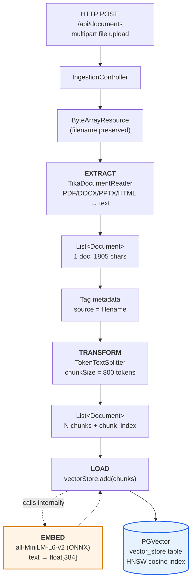

# Layer 1 — Document Ingestion

**Status:** Complete and verified
**Scope:** Turn an uploaded file into searchable vectors in PostgreSQL
**API key required:** No — this entire layer runs locally

---

## 1. What this layer does, and why it exists

RAG has two halves that people routinely conflate:

| Half | When it runs | What it does |
|---|---|---|
| **Ingestion** (Layer 1) | Ahead of time, once per document | Converts documents into vectors and stores them |
| **Retrieval + Generation** (Layers 2–3) | Per user question | Finds relevant vectors, feeds the text to an LLM |

Layer 1 is the *offline* half. Nothing here involves Claude. If ingestion is
wrong — bad chunking, wrong dimensions, lost metadata — no amount of prompt
engineering in Layer 3 will rescue it. **Most "the LLM gave a bad answer"
bugs in RAG are actually Layer 1 bugs.**

---

## 2. The pipeline



The orange box is the step **you never call directly**. `vectorStore.add()`
invokes the `EmbeddingModel` bean internally. That indirection is the reason
swapping embedding providers is a dependency change, not a code change.

---

## 3. Data transformation, stage by stage

Real numbers from the verified run on `sample-docs/company-handbook.txt`:

```
┌─────────────────────────────────────────────────────────────────────┐
│ STAGE 0 — UPLOAD                                                    │
│ company-handbook.txt ............................ 1,805 bytes       │
│ multipart/form-data → MultipartFile → ByteArrayResource             │
└─────────────────────────────────────────────────────────────────────┘
                                 ↓
┌─────────────────────────────────────────────────────────────────────┐
│ STAGE 1 — EXTRACT         new TikaDocumentReader(resource).read()   │
│                                                                     │
│ Tika sniffs the format and strips everything that is not text:      │
│ markup, binary headers, PDF layout, DOCX XML.                       │
│                                                                     │
│ OUT: List<Document>  size=1   content=1,805 chars of plain text     │
└─────────────────────────────────────────────────────────────────────┘
                                 ↓
┌─────────────────────────────────────────────────────────────────────┐
│ STAGE 2 — TAG             doc.getMetadata().put("source", filename) │
│                                                                     │
│ Done BEFORE splitting so every derived chunk inherits it.           │
│ This is what lets Layer 3 cite "according to company-handbook.txt". │
└─────────────────────────────────────────────────────────────────────┘
                                 ↓
┌─────────────────────────────────────────────────────────────────────┐
│ STAGE 3 — TRANSFORM              splitter.apply(documents)          │
│                                                                     │
│ chunkSize = 800 tokens  →  1 chunk   (doc is only ~450 tokens)      │
│ chunkSize = 120 tokens  →  4 chunks  (315, 512, 500, 474 chars)     │
│                                                                     │
│ The splitter ALSO injects metadata automatically:                   │
│   chunk_index, total_chunks, parent_document_id                     │
└─────────────────────────────────────────────────────────────────────┘
                                 ↓
┌─────────────────────────────────────────────────────────────────────┐
│ STAGE 4 — EMBED            (implicit, inside vectorStore.add)       │
│                                                                     │
│ all-MiniLM-L6-v2 runs in-process via ONNX Runtime. No network.      │
│ Each chunk's text → float[384]                                      │
│                                                                     │
│ [-0.16015553, -0.12794536, 0.12585087, -0.042256076, 0.08593752,    │
│  -0.17796439, -0.055528745, 0.1418549, ... ] (384 values)           │
│                                                                     │
│ Storage: 1,544 bytes = 384 × 4-byte float32 + 8-byte header         │
└─────────────────────────────────────────────────────────────────────┘
                                 ↓
┌─────────────────────────────────────────────────────────────────────┐
│ STAGE 5 — LOAD                  INSERT INTO vector_store            │
│                                                                     │
│ id        uuid         d4787dc4-2fd4-4cb1-bbdd-9d9c1ad90e59         │
│ content   text         the chunk's plain text                       │
│ metadata  json         {"source":..., "chunk_index":0, ...}         │
│ embedding vector(384)  the float array above                        │
└─────────────────────────────────────────────────────────────────────┘
```

---

## 4. Why embeddings make search work

A traditional `LIKE '%vacation%'` query matches **characters**. An embedding
matches **meaning**.

The model maps text to a point in 384-dimensional space, positioned so that
semantically similar text lands nearby — even with zero shared words:

```
        384-dimensional space (flattened to 2D for illustration)

               "deployment policy"  ●
                                     ╲
                                      ╲  small angle = similar
                                       ╲
               "when can we ship?"   ●

               "robot battery life"              ●
                                                   large angle = unrelated
```

Similarity is the **cosine of the angle** between two vectors. At query time
(Layer 2) your question is embedded with the *same model*, and Postgres finds
the chunks with the smallest cosine distance.

> **This is why changing the embedding model forces a full re-ingest.**
> Vectors from different models live in incompatible coordinate systems.
> Comparing them produces numbers that look valid and mean nothing.

---

## 5. Code walkthrough

### `IngestionController` — the HTTP edge

```java
@PostMapping(consumes = MediaType.MULTIPART_FORM_DATA_VALUE)
public Map<String, Object> upload(@RequestParam("file") MultipartFile file) {
    String filename = file.getOriginalFilename();

    // Tika partly sniffs content type from the FILENAME, which a plain
    // ByteArrayResource does not carry — hence the override.
    Resource resource = new ByteArrayResource(file.getBytes()) {
        @Override public String getFilename() { return filename; }
    };

    int chunks = ingestionService.ingest(resource, filename);
    return Map.of("source", filename, "chunks", chunks);
}
```

The anonymous subclass is not decoration. Without `getFilename()`, Tika loses a
major format-detection signal and misparses some uploads.

### `IngestionService` — the ETL triple

```java
public int ingest(Resource resource, String sourceName) {
    // EXTRACT
    List<Document> documents = new TikaDocumentReader(resource).read();

    // Tag BEFORE splitting so chunks inherit the source
    documents.forEach(doc -> doc.getMetadata().put("source", sourceName));

    // TRANSFORM
    List<Document> chunks = splitter.apply(documents);

    // LOAD — embeddings are generated inside this call
    vectorStore.add(chunks);

    return chunks.size();
}
```

Spring AI models this as three composable interfaces:

| Interface | Really just | Our implementation |
|---|---|---|
| `DocumentReader` | `Supplier<List<Document>>` | `TikaDocumentReader` |
| `DocumentTransformer` | `Function<List<Document>, List<Document>>` | `TokenTextSplitter` |
| `DocumentWriter` | `Consumer<List<Document>>` | `VectorStore` |

Because they are plain functional interfaces, the whole pipeline can collapse
to one line — useful to recognise in other people's code:

```java
vectorStore.accept(splitter.apply(reader.get()));
```

---

## 6. Chunk size: the knob that matters most

The document is ~450 tokens. At the default `chunk-size: 800` it stays whole;
at 120 it splits into four:

| `chunk-size` | Chunks | Chars per chunk |
|---|---|---|
| 800 (default) | 1 | 1805 |
| 120 | 4 | 315, 512, 500, 474 |

**The tradeoff:**

```
   too small (50 tokens)          balanced (500-800)         too large (4000)
   ───────────────────            ──────────────────         ────────────────
   "The response time             "SEV-1 means complete      [entire handbook]
    target is 5 minutes"           loss of service. The
                                   response time target      Retrieves on any
   Retrieves precisely, but        is 5 minutes and it       query, but 95% of
   WHAT has a 5 minute             pages the VP."            what reaches the
   target? Context is lost.                                  LLM is irrelevant
                                   Self-contained.           filler.
```

Because it is externalised to config, you can sweep it without touching code:

```bash
docker exec rag-pgvector psql -U rag -d ragdb -c "TRUNCATE vector_store;"
./mvnw spring-boot:run -Dspring-boot.run.arguments="--rag.chunking.chunk-size=300"
```

Always truncate first — otherwise you are comparing a mix of old and new chunks.

---

## 7. What the database actually holds

```sql
                     Table "public.vector_store"
  Column   |    Type     | Nullable |      Default
-----------+-------------+----------+--------------------
 id        | uuid        | not null | uuid_generate_v4()
 content   | text        |          |
 metadata  | json        |          |
 embedding | vector(384) |          |
Indexes:
    "vector_store_pkey" PRIMARY KEY, btree (id)
    "spring_ai_vector_index" hnsw (embedding vector_cosine_ops)
```

Created automatically by `initialize-schema: true`, along with three extensions:
`vector`, `hstore`, `uuid-ossp`.

A stored row's metadata — note the three fields the splitter added for free:

```json
{
  "source": "company-handbook.txt",
  "chunk_index": 0,
  "total_chunks": 1,
  "parent_document_id": "927f71aa-5ddf-4eba-b166-e43419b52099"
}
```

`parent_document_id` lets you reconstruct which chunks came from the same
source document; `chunk_index` restores their original order. **Do not rely on
`id` for ordering** — it is a random UUID, so `ORDER BY id` returns chunks
scrambled.

### The HNSW index

`hnsw (embedding vector_cosine_ops)` builds a *Hierarchical Navigable Small
World* graph — an approximate nearest-neighbour structure. Exact search is
O(n): compare the query against every row. HNSW is ~O(log n), trading a tiny
recall loss for a very large speed gain. Irrelevant at 4 rows; essential at 4
million.

---

## 8. Verified measurements

| Metric | Value |
|---|---|
| Cold start (model pinned locally) | 6.7 s |
| Cold start (model downloaded from GitHub LFS) | 26.9 s |
| Embedding dimensions | 384 |
| Bytes per stored vector | 1,544 |
| Embedding L2 norm | **1.97 — not normalized** |
| Index | HNSW, `vector_cosine_ops` |
| ONNX model on disk | 87 MB |

> The vectors are **not** unit-length. `COSINE_DISTANCE` normalizes during
> comparison so this is correct as configured — but if you ever switch
> `distance-type` to `NEGATIVE_INNER_PRODUCT` expecting it to behave like
> cosine, you will get silently wrong rankings.

---

## 9. Traps

### The Git LFS pointer (costs hours if you hit it blind)

`spring-ai-transformers-2.0.2.jar` ships `model.onnx` as a **133-byte Git LFS
pointer**, not the model:

```
version https://git-lfs.github.com/spec/v1
oid sha256:e3dde332c13808c718680e7bf74a574e7e5d06f55bd6e1527e51509dcb8206f3
size 90387630
```

At default settings Spring AI downloads the real 90 MB file at startup into a
**randomly named** temp directory — so it re-downloads on *every* restart and
the app fails to start if the network blips. `application.yml` pins
`model-uri` to a local copy. Regeneration steps are in the README.

### …and the tokenizer does the same thing

**Correction to an earlier version of this document.** It claimed
`tokenizer.json` needed no pinning because the jar's copy is real (711 KB of
actual JSON, not an LFS pointer). That is true of the *file* but irrelevant to
the *behaviour*: Spring AI's default
`spring.ai.embedding.transformer.tokenizer.uri` points at
`raw.githubusercontent.com`, so it is fetched remotely on every startup too —
exactly like `model.onnx`.

This was invisible until a start happened to coincide with a slow network:

```
Caused by: java.lang.IllegalStateException: Failed to cache the resource:
  URL [https://raw.githubusercontent.com/.../all-MiniLM-L6-v2/tokenizer.json]
Caused by: java.net.ConnectException: Connection timed out
```

Startups that "worked" were quietly making two network calls. Both are now
pinned:

```yaml
onnx:
  model-uri: file:models/all-MiniLM-L6-v2/model.onnx
tokenizer:
  uri: file:models/all-MiniLM-L6-v2/tokenizer.json
```

Extract the tokenizer straight from the jar — no download needed:

```bash
unzip -o -j ~/.m2/repository/org/springframework/ai/spring-ai-transformers/2.0.2/spring-ai-transformers-2.0.2.jar \
  onnx/all-MiniLM-L6-v2/tokenizer.json -d models/all-MiniLM-L6-v2/
```

Only with **both** pinned does startup make zero network calls.

### Dimension mismatch fails late

`spring.ai.vectorstore.pgvector.dimensions` must equal the embedding model's
output (384 for MiniLM). PGVector defaults to **1536** (OpenAI-shaped). A
mismatch starts up fine and fails on the first `INSERT` — so it presents as an
ingestion bug, not a config bug.

| Model | Dimensions |
|---|---|
| all-MiniLM-L6-v2 (ours) | 384 |
| nomic-embed-text (Ollama) | 768 |
| text-embedding-3-small (OpenAI) | 1536 |

### The `chat.options.model` trap

In Spring AI 1.x the key was `spring.ai.anthropic.chat.options.model`. In 2.x
it is `spring.ai.anthropic.chat.model`. The old form does not error — it is
ignored, silently leaving you on the `claude-haiku-4-5` default.

### Re-uploading duplicates data

**Known gap, deliberately left in.** `ingest()` always inserts. Upload the same
file twice and every chunk exists twice, which skews retrieval toward
duplicated content. Production needs a delete-by-`source` before insert, or a
content-hash key. For now: `TRUNCATE vector_store` between experiments.

---

## 10. What Layer 1 deliberately does not do

| Not done | Which layer |
|---|---|
| Query the vectors | Layer 2 |
| Call Claude | Layer 3 |
| Deduplicate re-uploads | Known gap |
| Authenticate uploads | Out of POC scope |
| Process uploads asynchronously | Out of POC scope — large PDFs block the request thread |

---

## 11. Checkpoint

Layer 1 is working if all four hold:

```bash
# 1. App starts in <10s with no network calls
./mvnw spring-boot:run

# 2. Upload returns a chunk count
curl -X POST -F "file=@sample-docs/company-handbook.txt" \
  http://localhost:8080/api/documents
# → {"chunks":1,"source":"company-handbook.txt"}

# 3. Rows exist with 384 dims
docker exec rag-pgvector psql -U rag -d ragdb -c \
  "SELECT metadata->>'source', vector_dims(embedding) FROM vector_store;"

# 4. Chunk count responds to chunk size
docker exec rag-pgvector psql -U rag -d ragdb -c "TRUNCATE vector_store;"
./mvnw spring-boot:run -Dspring-boot.run.arguments="--rag.chunking.chunk-size=120"
# re-upload → {"chunks":4}
```

**Next:** Layer 2 adds `GET /api/search` to query these vectors directly and
see similarity scores — with no LLM involved. That ordering is deliberate:
when a RAG answer is wrong, you need to know whether retrieval or generation
failed, and you can only know that if you have looked at retrieval alone.
