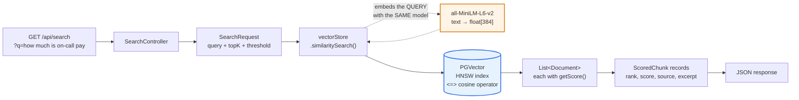

# Layer 2 — Semantic Retrieval

**Status:** Complete and verified
**Scope:** Query the vectors from Layer 1 and inspect similarity scores
**API key required:** No — still entirely local
**Endpoint:** `GET /api/search?q=…&topK=4&threshold=0.0`

---

## 1. Why retrieval gets its own layer

It would be shorter to jump straight from ingestion to a chatbot. That is also
the single most common way RAG projects get stuck.

When a RAG system gives a bad answer there are exactly two suspects:

```
                      BAD ANSWER
                          │
            ┌─────────────┴─────────────┐
            │                           │
  retrieval fed the model        the model reasoned
     the WRONG chunks            badly over the RIGHT chunks
            │                           │
     the common case              the rarer case
            │                           │
      fix: chunking,              fix: prompt, model,
      threshold, reranking          effort level
```

From the outside both look identical — a confidently wrong answer. The only way
to tell them apart is to look at retrieval **in isolation**, which is exactly
what this endpoint is for. Build it before the chatbot and you can always
answer the first diagnostic question: *did the right text even reach the model?*

---

## 2. Query flow



As in Layer 1, the orange box is the step **you never call**. `.query(String)`
takes plain text; `similaritySearch` runs it through the `EmbeddingModel` bean
before touching Postgres.

---

## 3. Stage by stage

Real values from the verified run against 4 chunks of `company-handbook.txt`:

```
┌──────────────────────────────────────────────────────────────────────┐
│ STAGE 0 — HTTP                                                       │
│ GET /api/search?q=how+much+is+on-call+pay&topK=3&threshold=0.1       │
│ → SearchController binds q / topK / threshold                        │
└──────────────────────────────────────────────────────────────────────┘
                                 ↓
┌──────────────────────────────────────────────────────────────────────┐
│ STAGE 1 — BUILD REQUEST                                              │
│ SearchRequest.builder()                                              │
│     .query("how much is on-call pay")   ← still TEXT at this point   │
│     .topK(3)                                                         │
│     .similarityThreshold(0.1)                                        │
│     .build()                                                         │
└──────────────────────────────────────────────────────────────────────┘
                                 ↓
┌──────────────────────────────────────────────────────────────────────┐
│ STAGE 2 — EMBED THE QUERY            (implicit, in-process, ~5ms)    │
│                                                                      │
│ "how much is on-call pay"  →  float[384]                             │
│                                                                      │
│ Same all-MiniLM-L6-v2 weights used at ingestion. This is the whole   │
│ ballgame: both sides must share a coordinate system.                 │
└──────────────────────────────────────────────────────────────────────┘
                                 ↓
┌──────────────────────────────────────────────────────────────────────┐
│ STAGE 3 — NEAREST-NEIGHBOUR SCAN                       (in Postgres) │
│                                                                      │
│ ORDER BY embedding <=> $queryVector  LIMIT 3                         │
│                                                                      │
│ <=> is pgvector's cosine-distance operator.                          │
│ Served by the HNSW index, not a sequential scan.                     │
└──────────────────────────────────────────────────────────────────────┘
                                 ↓
┌──────────────────────────────────────────────────────────────────────┐
│ STAGE 4 — SCORE + FILTER                                             │
│                                                                      │
│ score = 1 - cosine_distance                                          │
│ drop every row with score < 0.1                                      │
└──────────────────────────────────────────────────────────────────────┘
                                 ↓
┌──────────────────────────────────────────────────────────────────────┐
│ STAGE 5 — MAP TO JSON                                                │
│                                                                      │
│ Document.getScore()         → score                                  │
│ metadata["source"]          → source                                 │
│ metadata["chunk_index"]     → chunkIndex                             │
│ getText() collapsed to 300c → excerpt                                │
└──────────────────────────────────────────────────────────────────────┘
```

---

## 4. The symmetry that makes it work

```
  INGESTION (Layer 1)                QUERY (Layer 2)
  ───────────────────                ───────────────
  "Primary on-call                   "how much do I get
   receives a stipend                 paid for being
   of 800 dollars"                    on call"
          │                                  │
          ▼                                  ▼
   ┌─────────────┐                    ┌─────────────┐
   │ MiniLM-L6-v2│  ◄─── SAME ────►   │ MiniLM-L6-v2│
   └─────────────┘       MODEL        └─────────────┘
          │                                  │
          ▼                                  ▼
    float[384]  ─────── cosine ──────►  float[384]
                      similarity
                       = 0.5295
```

Both sides **must** use the same embedding model. Vectors from different models
occupy unrelated coordinate systems — comparing them yields numbers that look
plausible and mean nothing. There is no error, no warning, just quietly
meaningless rankings. **This is why changing the embedding model forces a full
re-ingest.**

---

## 5. What actually happens inside PGVector

### The distance operator

pgvector adds three distance operators. We use `<=>`, selected by the
`distance-type: COSINE_DISTANCE` setting in `application.yml`:

| Operator | Distance | Index opclass |
|---|---|---|
| `<=>` | Cosine | `vector_cosine_ops` ← ours |
| `<->` | Euclidean (L2) | `vector_l2_ops` |
| `<#>` | Negative inner product | `vector_ip_ops` |

### Score is derived, not stored

```
score = 1 - cosine_distance
```

Measured directly — probing chunk #3 against all four chunks:

```
 chunk | cosine_distance | score
-------+-----------------+--------
 3     |          0.0000 | 1.0000     ← itself: zero distance, perfect score
 1     |          0.5528 | 0.4472
 0     |          0.6916 | 0.3084
 2     |          0.8577 | 0.1423
```

So `similarityThreshold(0.1)` is really "cosine distance below 0.9".

### The query plan proves the index is used

```
 Limit
   ->  Index Scan using spring_ai_vector_index on vector_store
         Order By: (embedding <=> $1)
```

`Index Scan`, not `Seq Scan` — the HNSW graph is doing the work.

### What HNSW actually is

A *Hierarchical Navigable Small World* graph: layered proximity graphs where
upper layers are sparse for coarse jumps and lower layers dense for refinement.

```
  Layer 2    ●─────────────────────●              few nodes, long hops
             │                     │
  Layer 1    ●────────●────────●───●              medium density
             │        │        │   │
  Layer 0    ●──●──●──●──●──●──●──●──●──●──●      every vector

             ▲
             └─ a search enters at the top, greedily hops toward the
                query vector, then descends and refines
```

| | Exact scan | HNSW |
|---|---|---|
| Complexity | O(n) | ~O(log n) |
| Recall | 100% | ~95–99% |
| At 4 rows | instant | instant |
| At 10M rows | seconds | milliseconds |

**HNSW is approximate.** The recall it trades away is the price of the speed.
At this scale you will never see a miss; at millions of rows a genuinely
relevant chunk occasionally will not surface. That is the intended bargain.

---

## 6. Code

### `SearchService` — the whole thing

```java
public List<ScoredChunk> search(String query, int topK, double threshold) {
    SearchRequest request = SearchRequest.builder()
            .query(query)                       // embedded internally
            .topK(topK)                         // max hits
            .similarityThreshold(threshold)     // min score, 0.0-1.0
            .build();

    List<Document> hits = vectorStore.similaritySearch(request);
    if (hits == null) {
        hits = List.of();
    }
    // ... map each Document to a ScoredChunk, capturing doc.getScore()
}
```

### API surface used

Verified against the 2.0.2 jars with `javap` rather than assumed:

| Call | Returns |
|---|---|
| `SearchRequest.builder()` | `.query(String)` `.topK(int)` `.similarityThreshold(double)` `.filterExpression(…)` |
| `VectorStore.similaritySearch(SearchRequest)` | `List<Document>` |
| `Document.getScore()` | `Double` |
| `Document.getText()` | `String` |

### The three knobs

| Knob | Default | Effect |
|---|---|---|
| `query` | required | Text to match semantically |
| `topK` | 4 | Hard cap on result count |
| `similarityThreshold` | 0.0 | Drop anything below. 0.0 = keep everything. |

---

## 7. Verified results

### It matches meaning, not keywords

```
Q: "how much do I get paid for being on call"

  1. score=0.5295  chunk#3  "...SECTION 4: ON-CALL COMPENSATION..."
  2. score=0.1619  chunk#1
  3. score=0.1101  chunk#0
```

The document never says "paid" — it says *"receives a stipend of 800 dollars
per week"*. `LIKE '%paid%'` returns nothing. The embedding scores it **0.53**,
more than 3× the next chunk.

```
Q: "when are we allowed to ship code to production"

  1. score=0.3893  chunk#0  "...SECTION 1: DEPLOYMENT POLICY..."
  2. score=0.2109  chunk#1
  3. score=0.1408  chunk#3
```

"ship code" never appears either. It matched *deployment policy* on meaning.

### Where it gets weaker

```
Q: "what happens if the entire system becomes unavailable to everybody"

  1. score=0.1913  chunk#1   ← contains "SEV-1 means complete loss of service"
  2. score=0.1439  chunk#0
```

Semantically a bullseye — "entire system unavailable to everybody" *is*
"complete loss of service for all customers", with almost no shared vocabulary.
But 0.19 vs 0.14 is a thin margin. The ranking is right; the confidence is not.
This is the case where a reranker earns its keep in production.

---

## 8. The most important result: search always returns something

```
Q: "what is the best topping for a pizza"      (threshold = 0.0)

  1. score=0.0272  chunk#3  "...SECTION 4: ON-CALL COMPENSATION..."
  2. score=0.0063  chunk#1  "...waived for changes that touch only docs..."
```

**There is no pizza in the handbook, and the search returned results anyway.**

Vector search is a *nearest*-neighbour operation, not a *relevant*-neighbour
one. It always hands back its `topK` best matches, however bad. Nothing in the
mechanism distinguishes "closest" from "close enough":

```
   WITHOUT threshold                    WITH threshold = 0.1
   ─────────────────                    ────────────────────
   query: "pizza topping"               query: "pizza topping"
          │                                    │
          ▼                                    ▼
   ┌──────────────┐                     ┌──────────────┐
   │ 0.027 chunk3 │                     │ 0.027 ✗ drop │
   │ 0.006 chunk1 │                     │ 0.006 ✗ drop │
   └──────────────┘                     └──────────────┘
          │                                    │
          ▼                                    ▼
   Layer 3 receives                     Layer 3 receives
   on-call pay policy                   NOTHING → can honestly
   as "context"                         say "I don't know"
          │
          ▼
   hallucinated or
   confusingly hedged answer
```

### The threshold is the fix

Measured sweep across a relevant and an irrelevant query.
**Corpus: `company-handbook.txt` only — 1 document, 4 chunks, `topK=4`.**

| threshold | "on-call pay" | "pizza topping" |
|---:|---:|---:|
| 0.0 | 4 hits | **2 hits** ❌ |
| 0.1 | 3 hits | **0 hits** ✅ |
| 0.3 | 1 hit | 0 hits |

> **Hit counts are corpus-dependent; scores are not.** Re-running the pizza
> query after adding `security-policy.txt` (2 documents, 8 chunks) returns
> **3** hits at threshold 0.0 instead of 2 — more chunks exist, so more of
> them clear "greater than zero". The *scores* stay in the same noise band,
> and 0.1 still filters all of them. Always record the corpus alongside a
> hit-count measurement; a bare "2 hits" goes stale the moment you ingest
> anything else.

At **0.1** the junk is gone and the real query keeps good coverage. At 0.3 it is
precise but down to a single chunk — safe, but risks dropping supporting context.

### topK and threshold are not interchangeable

```
  topK alone        "give me 4 things"       → always 4, even if all garbage
  threshold alone   "give me good things"    → could be 0, could be 500
  both              "up to 4 good things"    → what you actually want
```

`topK` bounds cost and prompt size. `threshold` bounds *quality*. You need both.

---

## 9. Calibrating the threshold for your model

Do **not** copy a threshold from a tutorial. Absolute cosine values depend
heavily on the embedding model, and MiniLM's are compressed toward zero:

```
  0.0        0.1        0.3         0.5              1.0
   │──────────│──────────│───────────│────────────────│
   │  noise   │   weak   │   good    │     strong     │
              ▲                       ▲
              │                       │
        pizza: 0.027            on-call: 0.53
        (correctly dropped)     (bullseye)

   ╳ a threshold of 0.75 — common in OpenAI-based examples —
     rejects EVERY query in this document, including the bullseye
```

| Observed here (MiniLM-L6-v2) | Interpretation |
|---|---|
| 0.50+ | Strong, direct hit |
| 0.30–0.50 | Good, on-topic |
| 0.15–0.30 | Weak but often correct — thin margin |
| < 0.10 | Noise |

Borrowing 0.75 presents as *"my RAG is broken, it returns nothing"*. The cause
is a constant copied across embedding models.

**Calibrate empirically:** run a handful of questions you know the answers to,
plus one deliberately off-topic question, then pick a threshold between the
worst good score and the best bad one.

### Scores are sensitive to surface form

The same question, differing only by a trailing question mark:

```
"can I plug a USB stick into my work laptop?"   -> 0.3507
"can I plug a USB stick into my work laptop"    -> 0.3549
```

A 0.004 swing from one punctuation character. Harmless here, but it means two
things in practice: don't treat a threshold as precise to three decimals, and
don't be surprised when a reworded question reorders near-tied results.

---

## 10. Scoping retrieval to one document

Similarity search has **no notion of "search only inside this file."** Naming a
document in the question text does nothing — those words just become part of
the embedding.

Measured. Same query, two documents ingested (8 chunks):

```
unscoped:
  0.2316  security-policy.txt    ← top hit is the WRONG document
  0.2056  company-handbook.txt
  0.1857  security-policy.txt    ← also wrong
  0.1825  company-handbook.txt

scoped to company-handbook.txt:
  0.2056  company-handbook.txt
  0.1825  company-handbook.txt
  0.1543  company-handbook.txt
```

The query was *"provide the information for all the details of company
handbook"*. Half the retrieved context came from the security policy — so an
LLM given that context correctly described sections from both files, which
reads to a user like the system being confused.

The fix is a metadata filter, not a better prompt:

```java
SearchRequest.builder()
    .query(query).topK(topK).similarityThreshold(threshold)
    .filterExpression(new FilterExpressionBuilder().eq("source", source).build())
    .build();
```

Exposed as `?source=` on `/api/search`, `"source"` on `/api/chat`, and a
**scope** dropdown in the UI.

> Note the scoped result returns **3** chunks, not 4 — the fourth fell below
> the 0.1 threshold. Filtering fixes *which* document you search; it does not
> make top-k cover a whole one. See §11.

---

## 11. Why top-k cannot summarise

The query above scores 0.18–0.23 across the board, against 0.61 for a specific
question like *"how much is on-call pay?"*. That gap is the point:

> *"Give me all the details of X"* is a question **about** a document, not a
> question **answerable from** a passage. It does not embed near any particular
> chunk, because no chunk looks like it.

Two structural problems, neither fixable by prompting:

| Problem | Why `topK` can't solve it |
|---|---|
| A summary needs every chunk | `topK=4` returns 4; a document may have 400 |
| A meta-question matches nothing well | Raising `topK` just adds more weakly-matching chunks, including from other documents |

So summarisation bypasses the vector store entirely — see
[Layer 3 §11](LAYER-3-CHAT.md#11-whole-document-summarisation). It loads all
chunks for one `source` by SQL, in `chunk_index` order, and sends the lot.

**The general lesson:** RAG is retrieval-augmented *question answering*.
"Summarise this document" is a different operation and needs a different data
path. Reaching for a bigger `topK` is the instinctive fix and the wrong one.

---

## 12. Idempotent re-ingestion (gap closed)

Layer 1 flagged that re-uploading a file duplicated its chunks. That directly
corrupts every measurement above — duplicates occupy multiple `topK` slots and
inflate apparent relevance — so it is fixed here.

`IngestionService.ingest()` now deletes existing chunks for that `source` first:

```java
Filter.Expression bySource = new FilterExpressionBuilder()
        .eq("source", sourceName)
        .build();
vectorStore.delete(bySource);
```

Built via `FilterExpressionBuilder` rather than string concatenation — a
filename containing a quote would otherwise break or inject into the expression.

Verified:

```
rows before: 4
re-upload #1 -> {"chunks":4} ; rows now: 4
re-upload #2 -> {"chunks":4} ; rows now: 4
```

```
Replacing 'company-handbook.txt': removed 4 existing chunk(s)
```

---

## 13. Try it

```bash
# Basic
curl -G --data-urlencode "q=how much is on-call pay" \
  http://localhost:8080/api/search | jq

# Both knobs
curl -G --data-urlencode "q=when can we deploy" \
  --data-urlencode "topK=3" --data-urlencode "threshold=0.15" \
  http://localhost:8080/api/search | jq

# Compact ranking view
curl -sG --data-urlencode "q=robot battery life" \
  http://localhost:8080/api/search \
  | jq -r '.results[] | "\(.rank). \(.score) \(.excerpt[0:60])"'

# Sweep thresholds to calibrate
for t in 0.0 0.1 0.2 0.3; do
  n=$(curl -sG --data-urlencode "q=your question here" \
        --data-urlencode "threshold=$t" \
        http://localhost:8080/api/search | jq '.resultCount')
  echo "threshold=$t -> $n hits"
done
```

The response echoes the parameters that produced it — which matters when
sweeping:

```json
{
  "query": "how much do I get paid for being on call",
  "topK": 3,
  "threshold": 0.0,
  "resultCount": 3,
  "results": [
    {
      "rank": 1,
      "score": 0.5295,
      "source": "company-handbook.txt",
      "chunkIndex": 3,
      "id": "…",
      "excerpt": "Doing so has caused three separate SEV-2 incidents. SECTION 4: ON-CALL COMPENSATION…"
    }
  ]
}
```

---

## 14. Limits, and what fixes them

| Limit | Consequence | Production fix |
|---|---|---|
| HNSW is approximate | Rare misses at scale | Tune `ef_search`, or exact scan for small sets |
| No reranking | Thin margins on weak matches (§7) | Retrieve ~20, rerank with a cross-encoder |
| No query transformation | Vague phrasing retrieves poorly | `RewriteQueryTransformer`, `MultiQueryExpander` |
| One embedding call per query | Network cost on hosted providers | Cache embeddings for repeated queries |
| Pure vector search | Misses exact IDs, error codes, names | Hybrid search — combine with BM25 / full-text |

The last one is worth internalising: embeddings are bad at exact tokens. A query
for error code `SEV-2` or an order number matches *semantically similar* text,
not the literal string. Production systems usually run vector **and** keyword
search, then fuse the rankings.

Spring AI exposes the first three through `RetrievalAugmentationAdvisor`'s
modular pipeline — `DocumentPostProcessor`, query transformers, and
`DocumentJoiner`.

---

## 15. Checkpoint

```bash
# 1. Relevant query ranks the right chunk first
curl -sG --data-urlencode "q=how much do I get paid for being on call" \
  http://localhost:8080/api/search | jq -r '.results[0] | "\(.score) chunk#\(.chunkIndex)"'
# → ~0.53 chunk#3

# 2. Off-topic query returns junk at threshold 0
curl -sG --data-urlencode "q=what is the best topping for a pizza" \
  http://localhost:8080/api/search | jq '.resultCount'
# → 2   (correct behaviour, and the reason thresholds exist)

# 3. Threshold filters it out
curl -sG --data-urlencode "q=what is the best topping for a pizza" \
  --data-urlencode "threshold=0.1" \
  http://localhost:8080/api/search | jq '.resultCount'
# → 0

# 4. Re-upload does not duplicate
curl -sX POST -F "file=@sample-docs/company-handbook.txt" \
  http://localhost:8080/api/documents
docker exec rag-pgvector psql -U rag -d ragdb -t -c "SELECT count(*) FROM vector_store;"
# → still 4
```

**Next:** Layer 3 adds `POST /api/chat`, wiring these chunks into a Claude
prompt via `QuestionAnswerAdvisor`. The threshold calibrated here becomes the
guard deciding what Claude is allowed to see — which is precisely why this
layer came first.
