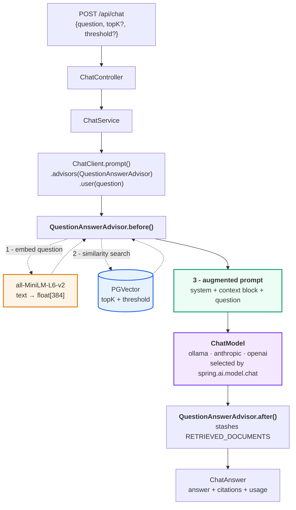

# Layer 3 — Grounded Chat

**Status:** Complete, verified end-to-end with **no API key** (via Ollama)
**Scope:** Feed retrieved chunks to an LLM and return a grounded, cited answer
**Endpoints:** `POST /api/chat` · `GET /api/info`
**Providers:** `ollama` (default — local, free) · `anthropic` · `openai`

---

## 1. What changes in this layer

Layers 1 and 2 are deterministic: the same input always produces the same
vectors and the same ranking. Layer 3 introduces the first component that can
phrase the same facts differently on two consecutive calls.

```
  Layer 1   file  ─────────────────────►  vectors in Postgres
            local · free · deterministic

  Layer 2   question  ────────────────►  ranked chunks + scores
            local · free · deterministic

  Layer 3   question + chunks  ───────►  natural-language answer
            local by default · free by default · NON-deterministic
```

Note what did **not** change. With the default `ollama` provider the whole
stack still runs on your machine at zero cost. What Layer 3 adds is
non-determinism — network and billing arrive only if you switch to a hosted
provider.

The mechanism is otherwise identical to Layer 2: same vector store, same
embedding model, same threshold. Layer 3 takes those chunks, pastes them into a
prompt, and asks a model.

That is genuinely all RAG is. **The intelligence is in the retrieval.**

---

## 2. Full pipeline



The purple box is the only swappable part. Everything feeding into it is
provider-independent.

---

## 3. Providers

Three chat starters sit on the classpath. `spring.ai.model.chat` activates
exactly one; the other two auto-configurations stay dormant.

| Provider | Model | Key | Cost | Speed (this machine) |
|---|---|---|---|---|
| **`ollama`** (default) | `llama3.2:3b` | none | free | ~30–60 s (CPU) |
| `anthropic` | `claude-opus-4-8` | `ANTHROPIC_API_KEY` | paid | ~2–5 s |
| `openai` | `gpt-4o-mini` | `OPENAI_API_KEY` | paid | ~2–5 s |

```bash
./mvnw spring-boot:run                                    # ollama (default)
./mvnw spring-boot:run -Dspring-boot.run.profiles=anthropic
./mvnw spring-boot:run -Dspring-boot.run.profiles=openai
```

Retrieval, embeddings and the vector store are **identical** in all three.
Only generation changes — which is precisely why the retrieved context, not
the model, does the heavy lifting.

### Verifying which one is live

A typo in `spring.ai.model.chat` leaves you on a different model than you
think, silently. `GET /api/info` reads the answer off the bean, not the config:

```json
{
  "chatProvider": "ollama",
  "chatModel": "llama3.2:3b",
  "chatImplementation": "OllamaChatModel",
  "embeddingModel": "TransformersEmbeddingModel",
  "embeddingDimensions": 384,
  "requiresApiKey": false
}
```

The UI renders this as a badge in the top-right, green when no key is needed.

### ⚠️ Pin the embedding model

```yaml
spring:
  ai:
    model:
      chat: ollama
      embedding: transformers   # ← do not remove
```

The OpenAI and Ollama starters each ship their **own** `EmbeddingModel`.
Without the pin, one of them could supply embeddings at a different dimension
than the 384 the `vector_store` table was created with. That fails at
**insert** time, not startup — so it surfaces as an ingestion bug long after
the real change.

### Keys, when you need one

Put the key in `config/application.yml` (gitignored, read automatically):

```bash
cp config/application.yml.example config/application.yml
```

Prefer that over `export`. An `export` applies only to the shell it was typed
in, so it never reaches a process started by a different shell, IDE, or tool —
a failure mode that looks exactly like an invalid key.

---

## 4. What the advisor does to your prompt

This is the part worth understanding, because it is invisible in the code.

You write this:

```java
chatClient.prompt()
    .advisors(advisor)
    .user("how much is on-call pay?")
    .call()
```

The model receives something closer to this:

```
┌─ SYSTEM ────────────────────────────────────────────────────────────┐
│ You answer questions strictly from the provided context documents.  │
│ - Use only information present in the context...                    │
│ - If the context does not contain the answer, say so plainly...     │
└─────────────────────────────────────────────────────────────────────┘

┌─ USER ──────────────────────────────────────────────────────────────┐
│ how much is on-call pay?                                            │
│                                                                     │
│ Context information is below, surrounded by ---------------------   │
│                                                                     │
│ ---------------------                                               │
│ Doing so has caused three separate SEV-2 incidents.                 │
│ SECTION 4: ON-CALL COMPENSATION                                     │
│ Engineers on the primary on-call rotation receive a stipend of 800  │
│ dollars per week. Secondary on-call receives 300 dollars per week.  │  ← chunk#3
│ ...                                                                 │
│ ---------------------                                               │
│                                                                     │
│ Given the context information and no prior knowledge, answer the    │
│ query.                                                              │
└─────────────────────────────────────────────────────────────────────┘
```

**Chunks are injected into the user turn, not the system prompt.** The
`QuestionAnswerAdvisor` owns that context block and its template; your
`defaultSystem(...)` sits above it as standing policy.

Two consequences:

- **Prompt size scales with `topK`.** Four 800-token chunks is ~3,200 tokens of
  context on *every* request. `topK` is a cost lever, not just a quality lever.
- **The model only sees what retrieval found.** If Layer 2 missed the chunk, no
  amount of prompting recovers it. This is why Layer 2 came first.

> Observed: `llama3.2:1b` echoed those `---------------------` delimiters
> straight into its answer. `3b` does not. Template leakage is a
> model-capability symptom, not a bug in the advisor.

---

## 5. Stage by stage

```
┌──────────────────────────────────────────────────────────────────────┐
│ STAGE 0 — REQUEST                                                    │
│ POST /api/chat {"question": "how much is on-call pay?"}              │
│ topK / threshold omitted → fall back to rag.retrieval.* config       │
└──────────────────────────────────────────────────────────────────────┘
                                 ↓
┌──────────────────────────────────────────────────────────────────────┐
│ STAGE 1 — BUILD ADVISOR                                              │
│ QuestionAnswerAdvisor.builder(vectorStore)                           │
│     .searchRequest(topK=4, similarityThreshold=0.1)                  │
│                                                                      │
│ Same SearchRequest type Layer 2 uses. Identical retrieval.           │
└──────────────────────────────────────────────────────────────────────┘
                                 ↓
┌──────────────────────────────────────────────────────────────────────┐
│ STAGE 2 — RETRIEVE          (advisor.before(), all local, ~5ms)      │
│ embed question → cosine search → drop anything below 0.1             │
└──────────────────────────────────────────────────────────────────────┘
                                 ↓
┌──────────────────────────────────────────────────────────────────────┐
│ STAGE 3 — AUGMENT                                                    │
│ splice retrieved chunks into the user turn (see §4)                  │
└──────────────────────────────────────────────────────────────────────┘
                                 ↓
┌──────────────────────────────────────────────────────────────────────┐
│ STAGE 4 — GENERATE                              ← the only LLM call  │
│ ollama    -> POST localhost:11434   llama3.2:3b      local, free     │
│ anthropic -> POST api.anthropic.com claude-opus-4-8  needs key       │
│ openai    -> POST api.openai.com    gpt-4o-mini      needs key       │
└──────────────────────────────────────────────────────────────────────┘
                                 ↓
┌──────────────────────────────────────────────────────────────────────┐
│ STAGE 5 — ASSEMBLE RESPONSE                                          │
│ answer     ← chatResponse().getResult().getOutput().getText()        │
│ citations  ← context().get(RETRIEVED_DOCUMENTS)                      │
│ usage      ← chatResponse().getMetadata().getUsage()                 │
│ grounded   ← citations.isEmpty() == false                            │
└──────────────────────────────────────────────────────────────────────┘
```

---

## 6. Code

### The whole call

```java
QuestionAnswerAdvisor advisor = QuestionAnswerAdvisor.builder(vectorStore)
        .searchRequest(SearchRequest.builder()
                .topK(topK)
                .similarityThreshold(threshold)
                .build())
        .build();

ChatClientResponse response = chatClient.prompt()
        .advisors(advisor)
        .user(question)
        .call()
        .chatClientResponse();
```

`.chatClientResponse()` rather than `.content()` — `.content()` returns only
the answer string and discards the advisor context, which is where the
citations live.

Nothing here names a provider. `ChatClient.Builder` is injected, and Spring
supplies whichever `ChatModel` won the wiring.

### API surface used

Verified with `javap` against the 2.0.2 jars, not assumed:

| Symbol | Note |
|---|---|
| `org.springframework.ai.chat.client.advisor.vectorstore.QuestionAnswerAdvisor` | **The reference docs show `org.springframework.ai.advisor` — that package does not exist in 2.0.2.** |
| `QuestionAnswerAdvisor.RETRIEVED_DOCUMENTS` | Context key holding `List<Document>` |
| `ChatClientResponse.chatResponse()` / `.context()` | Answer / advisor context |
| `CallResponseSpec.chatClientResponse()` | Returns both, unlike `.content()` |
| `com.anthropic.errors.AnthropicServiceException.statusCode()` | Used in the error handler |

---

## 7. The grounding prompt

The advisor supplies context; the system prompt governs what the model may do
with it:

```java
private static final String SYSTEM_PROMPT = """
        You answer questions strictly from the provided context documents.

        Rules:
        - Use only information present in the context. Do not supplement it
          with prior knowledge.
        - If the context does not contain the answer, say so plainly and
          stop. Do not speculate or infer beyond what is written.
        - When you state a fact, keep the wording close to the source so it
          stays verifiable.
        - Be concise. Answer the question that was asked.
        """;
```

The "say so plainly" clause is load-bearing. Layer 2 proved weak chunks can
clear the threshold without containing the answer (a correct match scored just
0.19). Without an explicit instruction to decline, a model handed
marginally-relevant context produces a plausible answer rather than admitting
the gap.

### Two guards, not one

```
   threshold          →  controls WHAT the model sees
   system prompt      →  controls what the model DOES with it

   neither alone is sufficient:

   threshold only     →  model invents links between weak chunks
   prompt only        →  model dutifully reasons over irrelevant text
```

§9 shows what happens when the second guard fails.

---

## 8. Citations

Every answer carries the chunks that produced it. Real response:

```json
{
  "question": "how much is on-call pay?",
  "grounded": true,
  "topK": 4,
  "threshold": 0.1,
  "citations": [
    { "rank": 1, "score": 0.6091, "source": "company-handbook.txt",
      "chunkIndex": 3, "excerpt": "...SECTION 4: ON-CALL COMPENSATION..." }
  ],
  "usage": { "promptTokens": 483, "completionTokens": 84, "totalTokens": 567 }
}
```

`grounded: false` alongside a confident answer is the signal to distrust —
nothing cleared the threshold, so the model answered from its own knowledge.

This is not a UI nicety. It is the debugging tool: when an answer is wrong, the
citations immediately tell you whether **retrieval** or **generation** failed —
the distinction Layer 2 was built to expose.

---

## 9. Model size decides whether grounding holds

Same pipeline, same threshold, same prompt, same documents. Only the Ollama
model changed:

| Test | `llama3.2:1b` | `llama3.2:3b` |
|---|---|---|
| Grounded answer (on-call pay) | Right figures, but leaked `---------------------` delimiters and then contradicted itself | Right figures, no leakage, mild hedging |
| **Honesty test** (pizza — 0 chunks retrieved) | ❌ **"Melted mozzarella cheese"** | ✅ "The text does not mention pizzas or toppings at all" |
| Cross-document routing (USB policy) | Correct source, terse answer | Correct source, quoted close to source |

In **both** runs retrieval behaved identically: `grounded: false`, zero
citations, nothing sent as context. The 1b model simply ignored the instruction
and answered from parametric memory.

**That is the lesson.** A similarity threshold controls what the model *sees*;
it cannot control what the model *says*. Grounding needs a retrieval guard
**and** a generator capable of honoring it. A team that tests RAG safety by
checking retrieval alone will ship this bug.

3b is therefore the default. 1b is noticeably faster and fails the one test
that matters.

---

## 10. Error handling

A bad key produced a bare `HTTP 500` with an empty body — indistinguishable
from a bug in retrieval. `ChatExceptionHandler` maps provider failures to
actionable responses:

| Upstream | Returned | Hint |
|---|---|---|
| 401 | 502 | Key missing/invalid; Layers 1–2 don't need one |
| 403 | 502 | Key valid, no access to this model |
| 404 | 502 | Unknown model id — check `spring.ai.<provider>.chat.model` |
| 429 | 429 | Rate limited, retry |
| 5xx | 502 | Provider-side, safe to retry |

**502, not 500** — this service is healthy; its dependency is not. A 500 would
wrongly implicate our own code.

Verified with a deliberately invalid key:

```json
{
  "error": "anthropic_api_error",
  "upstreamStatus": 401,
  "hint": "ANTHROPIC_API_KEY is missing or invalid. Export a valid key and
           restart. Layers 1-2 (/api/documents, /api/search) do not need one."
}
HTTP 502
```

The UI renders that `hint` directly in the chat as a red error bubble.

> Currently typed to `AnthropicServiceException`. OpenAI failures fall through
> to a generic 500 — a known gap, listed in §12.

---

## 11. Adaptive retrieval

Not every question wants the same retrieval. `/api/chat` picks a strategy per
request — there is no separate endpoint and no button to press.

| Strategy | When | What it does |
|---|---|---|
| `TOP_K` | specific questions | embed the question, take the nearest chunks |
| `FULL_DOCUMENT` | overview questions naming a document | skip similarity search, read every chunk in order |

### The failure that motivated it

Asking *"provide the information for all the details of company handbook"*
originally produced a confused, partial answer that listed sections and asked
which one to focus on. The retrieval explains why:

```
  0.2316  security-policy.txt   #1   ← wrong document, and the TOP hit
  0.2056  company-handbook.txt  #1
  0.1857  security-policy.txt   #0   ← wrong document
  0.1825  company-handbook.txt  #0
```

Half the context came from a different file, and four chunks cannot represent
a whole document. The model behaved correctly given what it was handed.

Note the uniformly low scores against 0.61 for a specific question. That gap
is the signal: **a question *about* a document does not resemble any
particular passage in it.**

### How the strategy is chosen

[`RetrievalPlanner`](../src/main/java/com/example/rag/chat/RetrievalPlanner.java)
combines two signals, before any retrieval runs.

**1. Intent — classified semantically, not by keyword.**
[`IntentClassifier`](../src/main/java/com/example/rag/chat/IntentClassifier.java)
embeds the question and compares it against two small sets of *prototype*
questions, using the same local model that powers retrieval:

```
  "what is in company handbook txt file?"
       │
       ├── nearest OVERVIEW prototype   0.56
       └── nearest SPECIFIC prototype   0.15   → OVERVIEW
```

A regex version came first and failed on exactly that question — it means the
same as "summarise the handbook", but matched none of
`summarise|overview|all the details|everything`. Every miss like that is one
more pattern bolted on, and the list is never finished. Measured
generalisation to phrasings that appear in **no** prototype list:

| Question | overview | specific | → |
|---|---:|---:|---|
| "whats inside the security policy" | 0.45 | 0.16 | FULL_DOCUMENT |
| "run me through the handbook" | 0.41 | 0.15 | FULL_DOCUMENT |
| "can I use a usb stick at work?" | 0.05 | 0.58 | TOP_K |

Cost: one local embed, ~5 ms. No LLM round trip, no network.

**The examples live in `application.yml`, not in Java.** They are domain
knowledge, not logic — a legal team and a support team phrase overview
requests differently, and neither should recompile:

```yaml
rag:
  intent:
    min-overview-similarity: 0.35
    overview-examples:
      - what is in this file?
      - walk me through the whole policy
      - ...
    specific-examples:
      - how much is the on-call stipend?
      - ...
```

When a real question routes the wrong way, add one example. That is cheaper
and more reliable than writing a rule.

### Why examples, and not an LLM — measured

The obvious objection is that examples are still authored. So the two
alternatives were measured on the same 20 questions:

| Approach | Correct | Latency | Notes |
|---|---:|---:|---|
| **examples + embeddings** | **20/20** | **~5 ms** | current |
| `llama3.2:3b` asked to classify | 16/20 | ~2 s | zero examples |
| corpus similarity alone | unusable | ~5 ms | zero examples |

All four LLM errors were SPECIFIC mistaken for OVERVIEW — the expensive
direction, triggering a needless whole-document read on an ordinary question.

The corpus-only idea was appealing: a question about *content* should resemble
some chunk, a question about the *document as an object* should not. But the
classes overlap with no usable margin:

```
  OVERVIEW max score vs corpus:  0.2580
  SPECIFIC min score vs corpus:  0.2791
                                 └── 0.02 apart
```

Against 0.65 vs 0.11 for the example-based classifier. A dozen examples in
config buys a 6× wider decision margin than either zero-example approach, at
400× less latency than the LLM.

**2. Document reference** — the question's words are scored against the words
in each **ingested** filename, so `company handbook txt file` →
`company-handbook.txt`. No hardcoded list; it adapts as documents come and go.

Both present → `FULL_DOCUMENT`. Otherwise `TOP_K`, scoped to the named
document when there is one.

### Two details that make it work

**The document name is stripped before classifying intent.** A filename is a
noun phrase that says nothing about whether the user wants an overview or one
fact — but it *is* part of the sentence embedding, so an unusual or lengthy
name drags the vector away from both prototype sets. Classifying
`"run me through the ___"` makes the decision independent of what the document
is called.

**A confidence floor stops noise becoming a decision.** When a question
resembles neither set, picking the larger of two weak numbers is meaningless:

```
  "what is in company handbook txt file?"  overview 0.56  specific 0.15  ← real
  "who won the world cup in 1998?"         overview 0.17  specific 0.11  ← noise
```

The second was classified OVERVIEW on a 0.055 margin and would have triggered
a pointless full-document read. Overview now requires ≥ 0.35 absolute
similarity; otherwise it falls back to `TOP_K`, where the similarity threshold
makes the model answer "not in the context".

### It refuses to guess

Two documents matching the same words, or an overview request naming none,
falls back to `TOP_K` rather than picking one:

```json
{ "strategy": "TOP_K",
  "strategyReason": "question asks for an overview but names no document — searched everything; name a document for a full summary" }
```

A coin flip presented as an answer is worse than a partial answer that says so.

### Every answer explains its own routing

```json
{ "strategy": "FULL_DOCUMENT",
  "source": "company-handbook.txt",
  "chunksUsed": 4, "chunksTotal": 4, "truncated": false,
  "strategyReason": "question asks for an overview of company-handbook.txt, so every chunk was read instead of the top matches" }
```

`strategyReason` is surfaced under every answer in the UI. Routing that
happens invisibly is impossible to debug when it picks wrong.

### Bounds

`rag.retrieval.max-full-document-chunks` (default 40) caps the prompt.
Exceeding it sets `truncated: true` with `chunksUsed < chunksTotal` and an
amber UI warning — a summary silently covering 40 of 400 chunks would be worse
than none.

> **The general rule:** RAG is retrieval-augmented *question answering*.
> "Summarise this" is a different operation needing a different data path.
> The instinctive fix — raise `topK` — makes it worse, pulling in more
> weakly-matching chunks from more documents.

---

## 12. Cost

Only applies to hosted providers. **Ollama is free** — the `usage` numbers
below are still reported, they just aren't billed.

```
  prompt  = system (~80 tok) + context (topK × chunk_size) + question
  output  = answer

  topK=4, chunk-size=120  →  483 input tokens    (measured)
  topK=4, chunk-size=800  →  ~3,300 input tokens (projected)
```

Levers, cheapest first:

| Lever | Effect |
|---|---|
| Use the Ollama default | Cost goes to zero |
| Lower `topK` | Linear cut in context tokens |
| Lower `chunk-size` | Smaller chunks, but see Layer 1 §6 tradeoff |
| Raise `threshold` | Fewer chunks clear the bar |
| Prompt caching | Hosted providers bill large shared prefixes at ~0.1× on reads |

The `usage` block in every response makes this measurable rather than
theoretical.

---

## 13. Limits

| Limit | Consequence | Fix |
|---|---|---|
| No conversation memory | Each request is independent; "what about secondary?" has no referent | Spring AI `ChatMemory` / `MessageChatMemoryAdvisor` |
| No streaming | Caller waits for the whole answer — painful at 30–60 s on CPU Ollama | `.stream()` instead of `.call()` |
| Error handler is Anthropic-typed | OpenAI/Ollama failures return a generic 500 | Catch the provider-neutral supertype too |
| Small local models hedge | `3b` answers correctly but verbosely | Larger local model, or a hosted provider |
| No inline source markers | Citations are listed, not mapped to sentences | Cite-by-id prompting |
| Synchronous | Request thread blocked for the whole generation | Async + polling, or SSE |
| Retrieval quality ceiling | Inherits every Layer 2 limit | Reranking, hybrid search, query rewriting |

The first is the most visible in practice: this is question-answering, not
conversation. Follow-ups depending on earlier turns will not resolve.

---

## 14. Checkpoint

**No API key needed** — these run against the default Ollama provider.
Allow 30–60 s per answer on CPU.

```bash
# 0. Provider is what you think it is
curl -s http://localhost:8080/api/info | jq '{chatProvider, chatModel, requiresApiKey}'
# → ollama / llama3.2:3b / false

# 1. Grounded answer with citations
curl -sX POST http://localhost:8080/api/chat \
  -H 'Content-Type: application/json' \
  -d '{"question":"how much is on-call pay?"}' \
  | jq '{grounded, citations: (.citations|length), usage}'
# → grounded=true, citations=4, non-zero totalTokens

# 2. Declines what it cannot ground   ← the test that matters
curl -sX POST http://localhost:8080/api/chat \
  -H 'Content-Type: application/json' \
  -d '{"question":"what is the best topping for a pizza?"}' \
  | jq '{grounded, answer}'
# → grounded=false, answer declines

# 3. Routes across documents
curl -sX POST http://localhost:8080/api/chat \
  -H 'Content-Type: application/json' \
  -d '{"question":"can I plug a USB stick into my work laptop?"}' \
  | jq '{top: .citations[0].source, answer}'
# → security-policy.txt, "No, personal USB storage devices may not be..."
```

### Verified results (2026-10-27, `ollama · llama3.2:3b`)

| Check | Result |
|---|---|
| Compiles against Spring AI 2.0.2 | ✅ |
| Beans wire; `/api/info` confirms `OllamaChatModel` | ✅ |
| Embeddings stay `TransformersEmbeddingModel` @ 384d | ✅ |
| Grounded answer | ✅ 4 citations, top score 0.6091 |
| Token usage populated | ✅ 483 in · 84 out · 567 total |
| Honesty test | ✅ declines, `grounded: false` |
| Cross-document routing | ✅ `security-policy.txt` @ 0.351 |
| Error handler returns actionable 502 | ✅ (tested with an invalid key) |
| Verified through the web UI | ✅ badge, citations, usage all render |
| **Anthropic / OpenAI providers** | ⚠️ **wired, not separately exercised** |

The last row is deliberate. Both share the identical code path — only the
`ChatModel` bean differs — but neither has been run with a live key, so it is
not claimed as verified.
